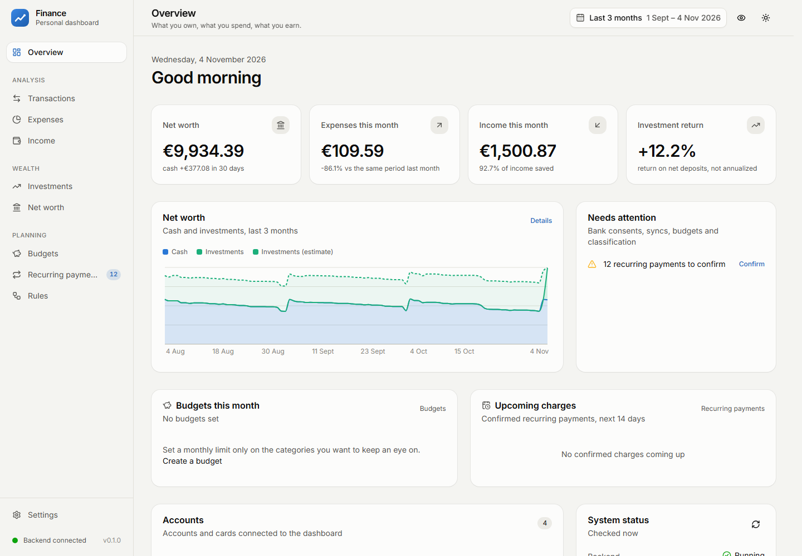
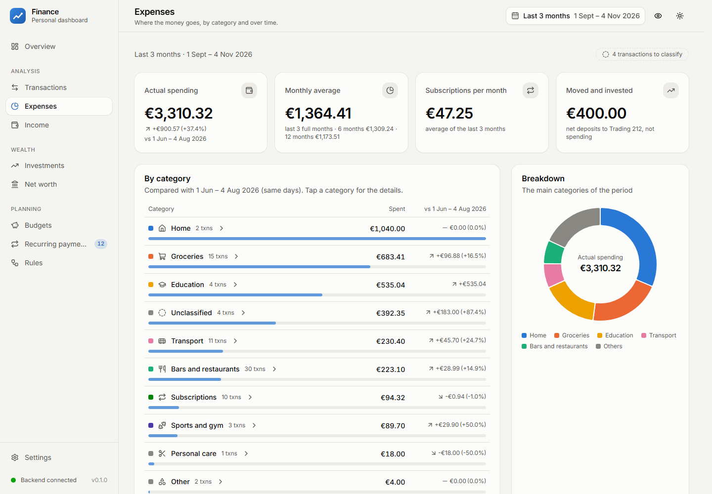
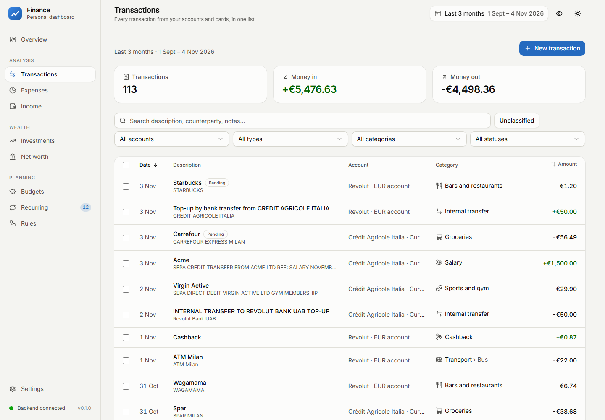
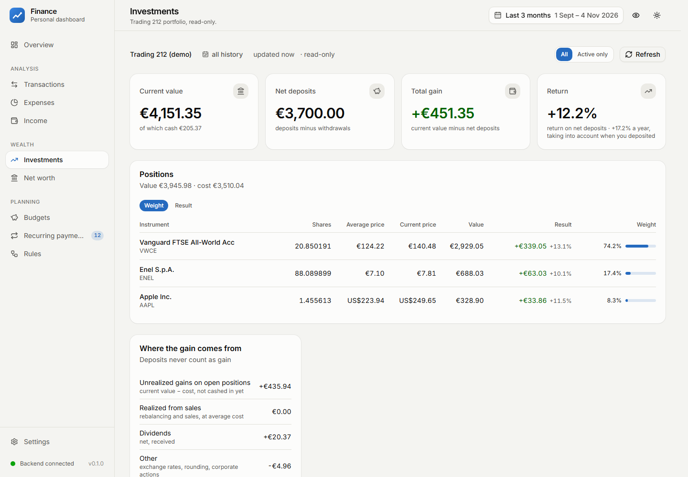
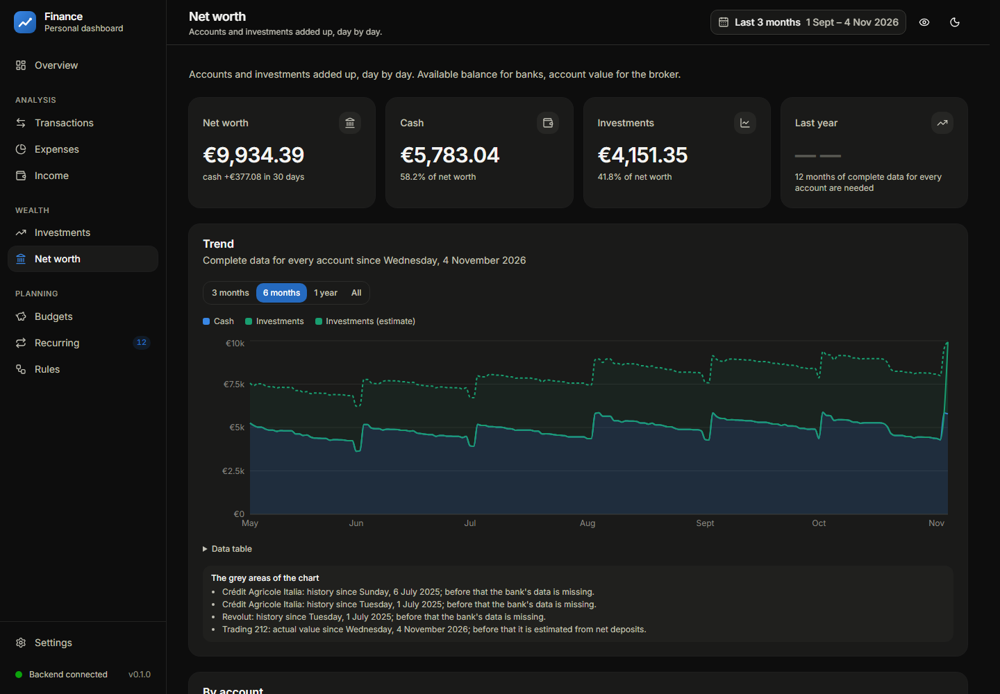
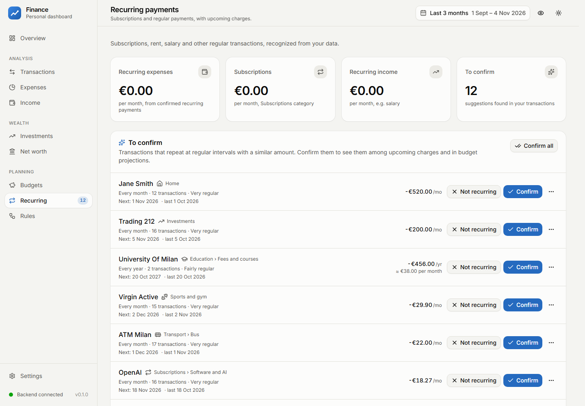
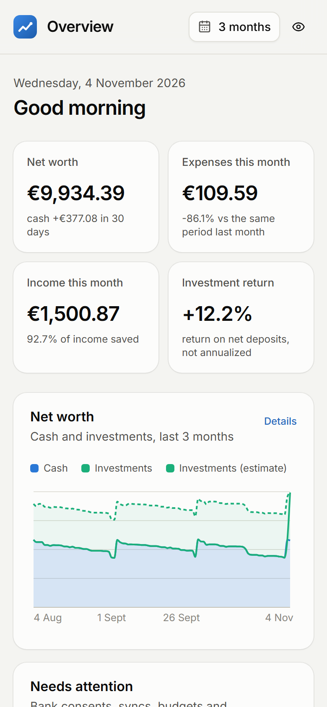
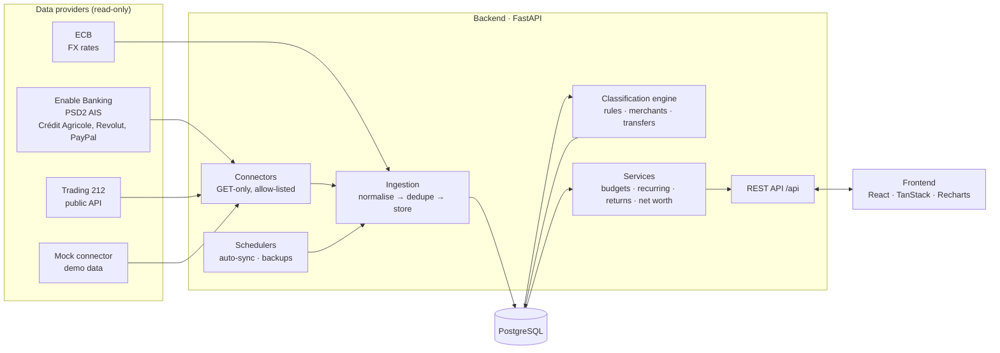

# Finance Dashboard

A self-hosted personal finance dashboard that brings bank accounts, cards and a brokerage
portfolio together in one place: where the money goes, how much comes in, how the investments
are really performing and what the total net worth is, day by day.

It connects to real banks through **Open Banking (PSD2)** and to **Trading 212** through its
official API, always **read-only**. It ships with a **demo mode** that generates 15+ months of
realistic fake data, so anyone can run it in a couple of minutes without any credentials.

> The user interface is in Italian (it was built for an Italian user and Italian banks).
> The design document ([docs/SPEC.md](docs/SPEC.md)) and the code comments are in Italian too.



## Built with Claude Code

This project was developed with [Claude Code](https://claude.com/claude-code), Anthropic's
agentic coding tool, under my direction. I defined the requirements and the 17-section
specification, split the work into 11 phases (0–10), made the product and architecture
decisions, reviewed every phase against real data and approved it before moving on.
Claude Code wrote the code, the tests and the documentation following that plan.

The phase-by-phase history (decisions, trade-offs and implementation notes) is preserved in
[docs/SPEC.md](docs/SPEC.md) and in the [architecture decision records](docs/decisions/).

## Features

- **Unified transactions** from every account and card: search, filters, inline editing,
  bulk actions, manual entries, pending → booked promotion without duplicates.
- **Automatic classification** with a deterministic pipeline: manual overrides → internal
  transfers → user rules → system rules → merchant defaults → MCC / provider category.
  Corrections can become rules ("apply to past and future transactions from this merchant"),
  and every transaction explains *why* it got its category.
- **Internal transfer detection**: money moved between your own accounts (bank → Revolut,
  credit card payoff, PayPal withdrawals) is never counted as spending or income.
- **Expenses and income** by category and over time, same-period comparisons,
  3/6/12-month averages, savings rate, merchant ranking.
- **Recurring payments** detected automatically (subscriptions, rent, salary) with expected
  amount and next date, plus **monthly budgets** with alerts and end-of-month projection.
- **Investments** (Trading 212): positions, average cost, realised and unrealised P/L,
  dividends, pies, and a return measured on net deposits that deposits can never inflate
  (XIRR only shown when it is statistically meaningful).
- **Net worth** history rebuilt from balances and transactions, with estimated and partial
  days clearly marked.
- **Privacy mode** (blur all amounts with one key), light/dark theme, mobile layout.
- **Security**: read-only integrations enforced at three levels (provider permissions,
  client allow-lists, no write endpoints), Fernet-encrypted provider sessions, optional
  password + TOTP login, encrypted backups with automatic restore verification, strict CSP,
  gitleaks pre-commit hook.

## Screenshots

| | |
|---|---|
|  |  |
|  |  |
|  |  |

All figures in the screenshots come from the built-in demo data.

## Architecture



- **Connectors** share one read-only interface (`list_accounts`, `get_balances`,
  `get_transactions`, broker positions/orders/dividends). The mock connector implements the
  same interface, so the demo data flows through exactly the same pipeline as real data.
- **Classification is recomputed from scratch** after every sync or rule change: the result
  depends only on data, rules and manual corrections, never on the order of syncs.
- **Money is never a float**: `NUMERIC(14,2)` in the database, `Decimal` in Python, strings in JSON.
- In production a single container serves both the API and the compiled frontend; the
  intended deployment is a home server reachable only through Tailscale
  ([docs/DEPLOY.md](docs/DEPLOY.md)).

## Tech stack

| Layer | Technologies |
|---|---|
| Backend | Python 3.12, FastAPI, SQLAlchemy 2, Alembic, Pydantic v2, httpx, PyJWT, cryptography |
| Database | PostgreSQL 18 |
| Frontend | React 19, TypeScript, Vite, Tailwind CSS 4, shadcn/ui (Radix), TanStack Query & Table, Recharts, openapi-fetch (types generated from the OpenAPI schema) |
| Quality | pytest (317 tests), Vitest + Testing Library (104 tests), ruff, mypy (strict), ESLint, Prettier |
| Security & ops | gitleaks + pre-commit, Argon2id + TOTP, AES-256-GCM backups, Docker, Tailscale |

## Quick start (demo)

The backend starts in **demo mode** by default (`DEMO_MODE=true`): on startup it applies the
database migrations, the seed (categories, merchants, rules) and generates fake accounts and
transactions up to today. No credentials are needed.

### Option A — everything in Docker

```sh
docker compose up --build
```

Then open <http://localhost:8000>.

If PostgreSQL already runs on port 5432 on your machine, publish the container database on
another port: `DB_PORT=5434 docker compose up --build` (and use 5434 in `DATABASE_URL` /
`TEST_DATABASE_URL` for option B).

### Option B — local development

Requirements: Python 3.12 + [uv](https://docs.astral.sh/uv/), Node 24 + pnpm, and PostgreSQL
(the easiest way is the database container from `compose.yaml`).

```sh
docker compose up -d db                  # PostgreSQL on 127.0.0.1:5432 with the finance and finance_test databases
cp config/.env.example backend/.env      # ready-made values for the database above

cd backend
uv sync
uv run uvicorn app.main:app --host 127.0.0.1 --port 8000   # migrations + demo data on startup

cd ../frontend                           # in a second terminal
pnpm install
pnpm dev                                 # http://localhost:5173
```

Using a PostgreSQL you installed yourself instead of Docker:

```sh
psql -U postgres -v app_pw='choose-a-password' -f database/create-databases.sql
```

and put the same password in `DATABASE_URL` and `TEST_DATABASE_URL` in `backend/.env`.

### Tests

```sh
cd backend && uv run pytest              # uses only the finance_test database
cd frontend && pnpm test
```

## Using it with your own accounts

1. Set `DEMO_MODE=false` in `backend/.env` and remove the demo data:
   `uv run python -m app.ingestion.cli mock-remove --yes` (it only touches mock sources).
2. **Trading 212**: create a read-only API key (never enable order or pie *write*
   permissions) and save it in `data/secrets/trading212.env`, then *Settings → Connect
   Trading 212*.
3. **Banks** (Crédit Agricole Italia, Revolut, PayPal and the other banks supported by
   Enable Banking): create a free application in the Enable Banking control panel
   (restricted production mode works for your own accounts), save the private key and
   `enablebanking.env` in `data/secrets/`, register the redirect URL, then
   *Settings → Connect a bank*. Production redirects must be `https`, also on localhost
   (a [mkcert](https://github.com/FiloSottile/mkcert) certificate in `data/secrets/tls/` is
   picked up automatically by Vite).
4. Optional: `OWNER_NAMES` and `HOME_PLACES` in `backend/.env` improve internal transfer and
   travel detection.

Step-by-step instructions (in Italian) are in [docs/SPEC.md §9](docs/SPEC.md); the
home-server deployment with Docker Compose, Tailscale and login is in
[docs/DEPLOY.md](docs/DEPLOY.md), the security checklist in [docs/SECURITY.md](docs/SECURITY.md).

Everything sensitive (keys, provider credentials, backups, logs) lives in `DATA_DIR`
(default `data/`), which is excluded from Git and from the Docker build context.

## Project structure

| Folder | Content |
|---|---|
| `backend/` | FastAPI app, models, Alembic migrations, connectors, classification engine, tests |
| `frontend/` | React + TypeScript single-page app |
| `database/` | Seeds (categories, merchants, rules), database creation scripts, schema notes |
| `config/` | `.env.example` and `db.env.example`: every setting, no real values |
| `deploy/` | Docker Compose for a home server with real data |
| `docs/` | Specification, architecture decision records, deployment and security guides |
| `scripts/` | Secret-scanning helper |

## License

[MIT](LICENSE)
